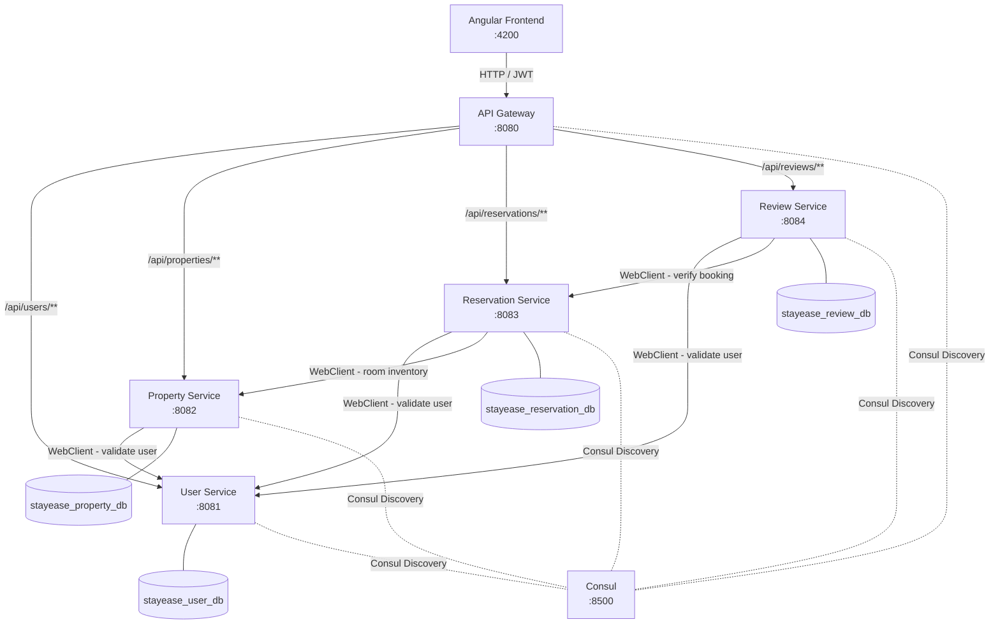

<p align="center">
  
  
  
  
  
  
</p>

<h1 align="center">🏨 StayEase — Hotel Reservation Platform</h1>
<p align="center">An enterprise-grade, full-stack hotel reservation platform built on a Spring Boot microservices architecture with an Angular 16 frontend.</p>

---

## About This Project

**StayEase** is a full-stack hotel reservation platform that enables guests to search, browse, and book hotels across India, and empowers administrators to manage properties, reservations, pricing, housekeeping, and audit trails — all through a clean microservices backend and a responsive Angular frontend.

The platform is built with five independently deployable Spring Boot microservices registered via **Spring Cloud Consul**, communicating over **WebClient** with **Resilience4j** circuit breakers, and secured end-to-end with **JWT-based authentication**. Each service owns its own isolated MySQL database — there are no cross-database joins.

---

## Features

### 🛎️ Guest Portal

| Feature | Details |
|---|---|
| **Registration** | Public sign-up with full name, email, phone, password (BCrypt hashed) |
| **Login / Logout** | JWT issued by User Service; stored in `localStorage`; cleared on logout; `tokenVersion` invalidation on password change |
| **Profile Management** | View and update personal details (name, phone, address, password) |
| **Browse & Search Hotels** | MakeMyTrip-style search widget with destination, dates, adults & children; strict validation (min 1 adult, no child-only bookings, check-in >= today) with Bootstrap text-danger spans |
| **Hotel Detail & Availability** | Real-time room availability per date range; 3-tier room card badges (Normal, Urgent low inventory with fire icon, and dimmed Sold Out state with disabled button when 0 rooms left) |
| **Room Booking** | Select room type; choose PREPAID (10-minute inventory hold with payment simulation) or PAY_LATER; booking confirmed with reference number (`SE-YYYY-XXXX`) |
| **Payment Simulation** | Realistic payment simulation: UPI (VPA pattern), Card (16-digit, MM/YY expiry, CVV), and Net Banking (top Indian banks); 10-minute hold with 60s background scheduler |
| **My Reservations** | View all bookings across 8 lifecycle statuses; invoice download, pre-stay cancellation, and conditional review action |
| **Self Check-In / Check-Out** | Guest-initiated check-in and check-out for confirmed/active bookings |
| **Submit Review** | Rate and review a stay after CHECKED_OUT status; strictly one review per user per booking (enforced in UI, service, and DB unique constraint); rating from 1 to 5 stars | Rate and review a stay after CHECKED_OUT status; one review per user per booking; rating from 1 to 5 stars |

### 🔑 Administrator Portal

| Feature | Details |
|---|---|
| **Admin Dashboard** | Operational metrics: current occupancy rate, today check-ins/check-outs, pending payments, total revenue, reservation status breakdown |
| **Hotel Property Management** | Create, update, deactivate hotels; manage amenities; upload hotel images |
| **Room Type Management** | Define room types per hotel (name, description, max guests, base nightly rate, image) |
| **Physical Room & Housekeeping** | Assign physical rooms; manage cleanliness (CLEAN, DIRTY, INSPECTING) and operational status (OPERATIONAL, OUT_OF_SERVICE) |
| **Pricing & Rate Overrides** | Set date-specific rate overrides on top of base nightly rate |
| **Admin Reservation Management** | View all reservations across all hotels; perform check-in, check-out, cancellation, no-show, and refund actions |
| **Review Moderation** | Moderate and remove inappropriate reviews with documented reasons and audit logging; active reviews display publicly |
| **Audit Trails** | Full audit log of all system events (AUTH, ACCOUNT, PROPERTY, RESERVATION, REVIEW) with before/after JSON snapshots |

---

## System Architecture



---

## Tech Stack

### Backend

| Technology | Version / Detail |
|---|---|
| Java | 21 |
| Spring Boot | 3.3.5 |
| Spring Cloud Gateway | Service entry point, JWT extraction, header propagation (`X-User-Id`, `X-User-Role`) |
| Spring Cloud Consul | Service discovery and registration |
| Spring Security + JWT (JJWT) | Stateless auth; `JwtAuthenticationFilter` on every service |
| Spring WebFlux WebClient | Reactive inter-service HTTP calls |
| Resilience4j | Circuit breakers on all WebClient calls |
| Spring Data JPA / Hibernate | ORM with `ddl-auto: update` |
| MySQL | 4 isolated databases (one per service) |
| Lombok | Boilerplate reduction (`@Data`, `@Builder`, `@Slf4j`) |
| MapStruct | DTO ↔ Entity mapping |

### Frontend

| Technology | Version / Detail |
|---|---|
| Angular | 16.2.x |
| TypeScript | 5.1.x |
| Bootstrap | 5.3.3 (CDN) |
| Bootstrap Icons | 1.11.3 (CDN) |
| RxJS | 7.8.x |
| Angular Route Guards | `AuthGuard` (authentication), `AdminGuard` (role check) |
| Google Fonts | Plus Jakarta Sans + Playfair Display |

---

## Getting Started

### Prerequisites

- **JDK 21** — `java -version` must show `21`
- **Apache Maven 3.9+** — `mvn -v`
- **Node.js 18+** and **npm** — `node -v`
- **Angular CLI 16** — `npm install -g @angular/cli@16`
- **MySQL 8+** — running locally on port `3306`
- **Consul** — binary available; download from [developer.hashicorp.com/consul](https://developer.hashicorp.com/consul/downloads)

### Setup

```bash
# 1. Start Consul (service discovery)
consul agent -dev

# 2. Initialize all four databases
#    Run each SQL script against MySQL (creates DB + tables)
mysql -u root -p < backend/user-service/src/main/resources/user_db.sql
mysql -u root -p < backend/property-service/src/main/resources/property_db.sql
mysql -u root -p < backend/reservation-service/src/main/resources/reservation_db.sql
mysql -u root -p < backend/review-service/src/main/resources/review_db.sql

# 3. Start each backend microservice
#    Open a separate terminal for each:
cd backend/api-gateway         && mvn spring-boot:run
cd backend/user-service        && mvn spring-boot:run
cd backend/property-service    && mvn spring-boot:run
cd backend/reservation-service && mvn spring-boot:run
cd backend/review-service      && mvn spring-boot:run

# 4. Bootstrap the admin account (one-time only)
#    Add to user-service application.yml, then restart user-service:
#      stayease.admin-bootstrap.enabled=true
#      stayease.admin-bootstrap.admin-email=admin@stayease.local
#      stayease.admin-bootstrap.admin-password=Admin@1234
#    Password is printed to stdout only. Disable the flag immediately after.

# 5. Start the Angular frontend
cd frontend/stayease-ui
npm install
ng serve
# App available at http://localhost:4200
```

> **Service ports:**
> API Gateway `:8080` · User Service `:8081` · Property Service `:8082` · Reservation Service `:8083` · Review Service `:8084` · Angular `:4200` · Consul `:8500`

---

## Default Seed Data

### Login Credentials

> The admin account is created via `AdminBootstrapRunner` on first startup when bootstrap is enabled.
> Guest accounts are registered through the public `/register` endpoint in the application.

| Role | Email | Password |
|---|---|---|
| Administrator | `admin@stayease.local` | *(set during bootstrap; default: `Admin@1234`)* |
| Guest | *(registered via UI)* | *(user-defined during registration)* |

### Seeded Records

| Entity | Count / Details |
|---|---|
| Hotels | 18 properties across Indian destinations |
| Destinations | Goa, Ooty, Jaipur, Udaipur, Mysore, Hyderabad, Chennai, Daman, Varanasi, Puri, Madurai, Bangalore, Gurgaon, Mumbai, Manali, Coorg, Munnar, Pune |
| Star Ratings | 4★ and 5★ properties |
| Room Types | 3 per hotel (e.g. Deluxe Ocean View, Superior Garden View, Family Suite) |
| Physical Rooms | Multiple operational rooms per room type |
| Amenities | Swimming Pool, Free WiFi, Restaurant, Spa, Gym, Parking, Bar, Concierge, etc. |
| Reservations | Created via frontend interactions (no SQL seed data) |
| Reviews | Created via frontend interactions (no SQL seed data) |

> **Note:** Hotel, room type, and amenity data is inserted manually through the **Admin Portal** after bootstrapping the admin account. The SQL scripts create the database schema only (no INSERT statements). All guest and reservation data is created through normal application usage.

---

## API Design & Security

| Concern | Implementation |
|---|---|
| **Authentication** | JWT Bearer tokens issued by User Service on login; validated in every downstream service via `JwtAuthenticationFilter` |
| **Authorization** | Role-based access — `ROLE_USER` for guest endpoints, `ROLE_ADMIN` for admin endpoints; enforced by Spring Security in each service |
| **Correlation & Token Forwarding** | Gateway assigns/propagates `X-Correlation-ID` and passes `Authorization: Bearer <token>`; downstream services validate JWT and verify `tokenVersion` via UserServiceClient |
| **Token Invalidation** | `tokenVersion` field incremented on password change or admin-triggered reset; existing JWTs rejected on mismatch |
| **Inter-Service Security** | Internal endpoints (e.g. `/internal/**`) protected by Spring Security; called only via WebClient from trusted services |
| **Circuit Breaker** | Resilience4j on all WebClient calls; fallback responses returned on upstream failures |
| **Input Validation** | Bean Validation (`@Valid`, `@NotBlank`, `@Min`, etc.) on all request DTOs; `@RestControllerAdvice` global exception handler |
| **CORS** | Configured in API Gateway for `http://localhost:4200` |

---

<p align="center">Author: Jagmohan Kushwaha</p>
