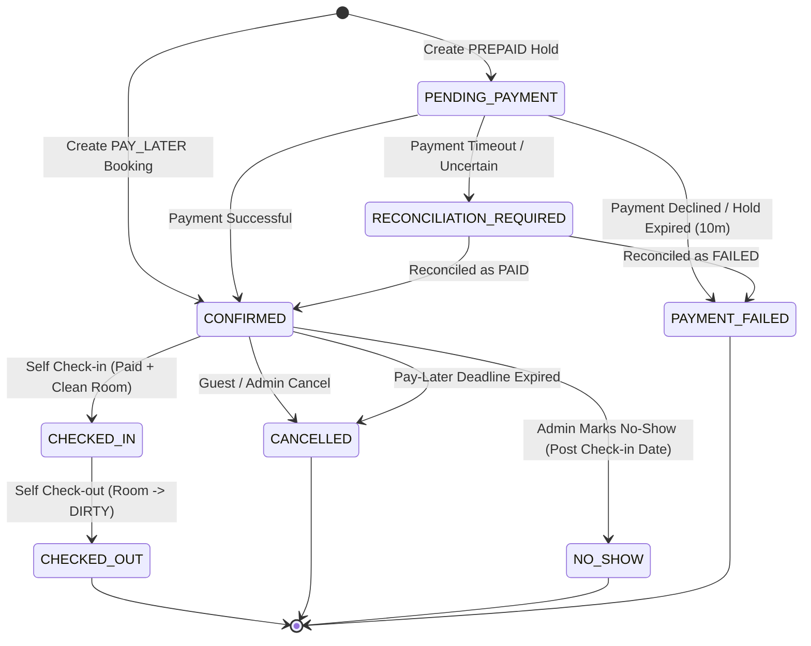

# StayEase Code-Ready Technical Decisions & Architectural Resolutions

**Document Version:** 1.1 (Phase 0 Contract Freeze)  
**Status:** Approved Architecture Baseline  
**Scope:** Reference Implementation Architecture & Governance  

---

## 1. Inventory Authority & Service-Call Direction

### Problem Statement
The preliminary draft (`docs/api-contract.md`) suggested Property Service exposed `/api/room-types/{roomTypeId}/availability`, while `StayEase_SRS_v1.1` and `docs/decisions.md v1.0` required Reservation Service to own inventory holds and active bookings. If Property Service exposed real-time availability, it would have to synchronously query Reservation Service for active holds/reservations. Since Reservation Service already queries Property Service for hotel, room-type, and rate definitions, this would create an illegal circular dependency.

### Architectural Decision
1. **Authoritative Ledger:** Reservation Service is the sole authoritative source of truth for real-time room-type availability, temporary inventory holds, and confirmed bookings.
2. **Metadata & Capacity Authority:** Property Service is the authoritative owner of hotel metadata, room-type specifications, total configured physical capacity, base/override pricing, amenities, and operational room status.
3. **Strict Unidirectional Service Calls:**
   - `Reservation Service` $\rightarrow$ `Property Service` (to validate hotel existence, room-type validity, rate structures, configured sellable capacity, and physical room readiness at check-in).
   - `Review Service` $\rightarrow$ `Reservation Service` (to validate reservation ownership, checkout status, and 30-day review eligibility window).
   - `Property Service` **NEVER** calls `Reservation Service`.
   - `User Service` is independent and queried by all services for `tokenVersion` validation.
4. **Endpoint Ownership:**
   - Property Service exposes catalog search and hotel discovery: `GET /api/hotels` (filtering on destination, price range, amenities, rating, max guest count).
   - Reservation Service exposes real-time date-range availability calculations:
     - `GET /api/reservations/availability?hotelId={id}&checkIn={date}&checkOut={date}&guests={count}`
     - `GET /api/reservations/room-types/{id}/availability?checkIn={date}&checkOut={date}&guests={count}`
   - Property Service exposes an internal endpoint for Reservation Service to query configured capacity:
     - `GET /internal/properties/room-types/{roomTypeId}/capacity`

---

## 2. Night Range, Calendar Rules & Timezones

1. **Occupancy Interval:** Stays occupy nights according to the half-open interval $[checkInDate, checkOutDate)$. The checkout date is the departure day and is **not** an occupied night.
   - Example: Check-in `2026-11-01`, Check-out `2026-11-04` occupies 3 nights (`2026-11-01`, `2026-11-02`, and `2026-11-03`).
2. **Date & Timestamp Formats:**
   - Stay dates are stored and exchanged as ISO-8601 `LocalDate` (`YYYY-MM-DD`).
   - System event timestamps and audit records are stored and exchanged as UTC `Instant` (ISO-8601 `YYYY-MM-DDTHH:mm:ss.SSSZ`).
3. **Application Business Timezone:**
   - Default business timezone is `Asia/Kolkata` (`UTC+05:30`), configured centrally via `stayease.time-zone=Asia/Kolkata`.
4. **Standard Hotel Operational Hours:**
   - Standard scheduled check-in time: `14:00:00` local time (`Asia/Kolkata`).
   - Standard scheduled check-out time: `11:00:00` local time (`Asia/Kolkata`).
5. **Pay-Later Deadline (`paymentDueAt`):**
   - For `PAY_LATER` reservations, payment is due at:
     $$\text{paymentDueAt} = \min(\text{createdAt} + 24\text{ hours}, \text{checkInDate at 14:00 local time})$$
   - If payment is not completed and verified before `paymentDueAt`, the reservation is automatically cancelled by the system with reason `PAYMENT_TIMEOUT`, and inventory is idempotently released.

---

## 3. Inventory Ledger, Concurrency & Locking Strategy

1. **Relational Ledger Model:**
   In `stayease_reservation_db`, inventory is tracked per night in table `room_type_inventory`:
   - `room_type_id` (BIGINT)
   - `stay_date` (DATE)
   - `total_capacity` (INT)
   - `reserved_count` (INT)
   - `hold_count` (INT)
   - `version` (BIGINT)
   - Primary Key: `(room_type_id, stay_date)`
2. **Concurrency & Locking Protocol:**
   - All capacity checks and hold/reservation creations occur inside a single `@Transactional` boundary in Reservation Service.
   - MySQL pessimistic row locking is used:
     ```sql
     SELECT * FROM room_type_inventory 
     WHERE room_type_id = :roomTypeId 
       AND stay_date >= :checkInDate 
       AND stay_date < :checkOutDate 
     ORDER BY stay_date ASC 
     FOR UPDATE;
     ```
   - Ordering by `stay_date ASC` is mandatory across all transactions to prevent database deadlocks.
   - If a date record does not exist in `room_type_inventory`, Reservation Service fetches `total_capacity` from Property Service and initializes the row with pessimistic locking.
3. **Capacity Invariant:**
   For every night $D \in [checkInDate, checkOutDate)$:
   $$\text{reserved\_count}_D + \text{hold\_count}_D + \text{requested\_rooms} \le \text{total\_capacity}_D$$
   If this condition fails for even a single night in the requested range, the transaction rolls back, and an `InsufficientInventoryException` (HTTP 409 Conflict) is thrown.
4. **Prepaid Temporary Hold:**
   - Hold duration is exactly **10 minutes** from creation.
   - During the hold, `hold_count` is incremented.
   - An asynchronous scheduler runs every 60 seconds finding unconfirmed holds where `createdAt + 10 minutes < now()` and status is `PENDING_PAYMENT`.
   - Expired holds transition to `PAYMENT_FAILED` (reason: `HOLD_EXPIRED`), and `hold_count` is decremented.
5. **Idempotent Inventory Release:**
   - Releasing inventory decrements `hold_count` (for holds) or `reserved_count` (for confirmed bookings).
   - Releasing operations are guarded by unique reservation IDs and current state checks to ensure capacity is never decremented more than once.

---

## 4. State Machines: Reservation & Payment

### 4.1 Reservation Status Lifecycle
Enums: `ReservationStatus`
- `PENDING_PAYMENT`: Initial state for `PREPAID` bookings; inventory hold is active.
- `CONFIRMED`: Inventory permanently reserved. Active for paid `PREPAID` or unexpired `PAY_LATER`.
- `CHECKED_IN`: Guest has completed self-check-in; physical room is assigned.
- `CHECKED_OUT`: Guest has completed self-check-out; physical room transitioned to `DIRTY`.
- `CANCELLED`: Reservation cancelled by guest, administrator, or system payment deadline expiry.
- `NO_SHOW`: Marked manually by Administrator after check-in date passed without guest arrival.
- `PAYMENT_FAILED`: Explicit failure of prepaid payment; hold released immediately.
- `RECONCILIATION_REQUIRED`: Payment simulator returned a network timeout / ambiguous state; hold frozen pending manual or scheduled reconciliation.



### 4.2 Payment Status Lifecycle
Enums: `PaymentStatus`
- `PENDING`: Awaiting payment (default for `PAY_LATER`).
- `PROCESSING`: Payment request in-flight or awaiting reconciliation.
- `PAID`: Payment successfully completed and confirmed.
- `FAILED`: Payment attempt rejected or declined.
- `REFUNDED`: Full or partial refund successfully processed.

### 4.3 Payment Idempotency & Reconciliation Rules
1. Every payment attempt must supply a client-generated UUID `idempotencyKey` in the request header (`Idempotency-Key`) or payload.
2. In `stayease_reservation_db`, `payment_transactions` enforces a unique constraint on `idempotency_key`.
3. If a duplicate request with an existing `idempotencyKey` arrives:
   - If the previous attempt is `PAID` or `FAILED`, the stored transaction result is returned immediately without re-invoking payment simulation.
   - If the previous attempt is `PROCESSING`, HTTP 409 (Conflict - Transaction in Progress) is returned.
4. **Uncertain Payment Outcome:**
   - If the simulated payment call times out, the reservation transitions to `RECONCILIATION_REQUIRED` and payment status remains `PROCESSING`.
   - Inventory hold remains protected until reconciliation is completed.
   - The reconciliation worker or administrator queries the payment transaction using the same `idempotencyKey`. A second transaction with a new key is **never** initiated automatically.
   - If a late payment success is confirmed after a hold was cancelled, the system marks the transaction `REFUND_REQUIRED` and alerts admin rather than double-booking capacity.

---

## 5. Pricing, Overrides, Tax & Monetary Precision

1. **Precedence Hierarchy:**
   For each individual night $D \in [checkInDate, checkOutDate)$:
   $$\text{Effective Rate}_D = \begin{cases} 
   \text{Seasonal Override Rate}, & \text{if a matching seasonal override exists for } D \\ 
   \text{Weekend Override Rate}, & \text{else if } D \text{ is Friday or Saturday and weekend rate exists} \\ 
   \text{Base Nightly Rate}, & \text{otherwise} 
   \end{cases}$$
2. **Taxation:**
   - A single configurable tax rate applies to the lodging subtotal:
     `stayease.pricing.tax-percentage=12.00`
   - Total calculation:
     $$\text{Lodging Subtotal} = \sum_{D} \text{Effective Rate}_D$$
     $$\text{Tax Amount} = \text{Lodging Subtotal} \times \left(\frac{\text{tax-percentage}}{100}\right)$$
     $$\text{Total Amount} = \text{Lodging Subtotal} + \text{Tax Amount}$$
3. **Monetary Precision & Rounding:**
   - Currency: `INR` (₹).
   - Java representation: `java.math.BigDecimal`.
   - Scale: 2 decimal places.
   - Rounding mode: `RoundingMode.HALF_UP`.
   - Floats or doubles must **never** be used for currency.
4. **Booking Price Snapshot:**
   At booking confirmation, an immutable snapshot is persisted in `reservation.price_snapshot_json`:
   - Exact breakdown of each night's date, rate applied, and override rule name.
   - Number of nights, subtotal, tax rate, tax amount, and final total.
   - All subsequent invoices, amendments, cancellation penalties, and refunds calculate strictly against this snapshot.
5. **Cancellation & Refund Calculations:**
   - Cancellation time is measured relative to scheduled check-in (`14:00:00` local time on `checkInDate`).
   - If cancellation occurs $\ge 24\text{ hours}$ before scheduled check-in:
     - Penalty = `0.00 INR`
     - Refund Amount = `amountPaid` (100% refund)
   - If cancellation occurs $< 24\text{ hours}$ before scheduled check-in:
     - Penalty = Night 1 rate from snapshot + applicable tax on Night 1 (`ROUND_HALF_UP`)
     - Refund Amount = $\max(0.00, \text{amountPaid} - \text{Penalty})$
   - If cancellation is due to `PAYMENT_TIMEOUT`:
     - Penalty = `0.00 INR`, Refund Amount = `0.00 INR`.

---

## 6. Physical Rooms, Housekeeping & Capacity Rules

1. **Status Definitions:**
   - `housekeeping_status`: `CLEAN`, `DIRTY`, `INSPECTING` (Operational cleanliness).
   - `operational_status`: `OPERATIONAL`, `OUT_OF_SERVICE` (Physical room availability).
2. **Impact on Sellable Capacity:**
   - Sellable Capacity for Room Type = $\text{Total Rooms of Type} - \text{Count}(\text{physical rooms WHERE operational\_status} = \text{'OUT_OF_SERVICE'})$.
   - Rooms marked `DIRTY` or `INSPECTING` **do not** reduce future sellable room-type capacity because they are expected to be cleaned before future dates.
   - Only physical rooms marked `OUT_OF_SERVICE` reduce the sellable capacity reported by Property Service.
3. **Check-in Assignment Rules:**
   - Physical rooms are assigned strictly at check-in time (`POST /api/reservations/{id}/check-in`), not at reservation booking.
   - Prerequisites for successful check-in:
     1. Reservation status must be `CONFIRMED`.
     2. Payment status must be `PAID`.
     3. Today's date matches `checkInDate` (local hotel time).
     4. A physical room of the booked `roomTypeId` is found where `housekeeping_status == 'CLEAN'` and `operational_status == 'OPERATIONAL'` and not currently assigned.
   - If no clean room is available, check-in is rejected with HTTP 409 (`No clean room ready for check-in; front desk alerted`). The reservation **remains CONFIRMED**.
4. **Checkout Rules:**
   - On checkout (`POST /api/reservations/{id}/check-out`):
     - Reservation transitions to `CHECKED_OUT`.
     - Physical room's `housekeeping_status` is automatically updated to `DIRTY` in Property Service.

---

## 7. Security Architecture, JWT & Token Validation

1. **Authentication Baseline:**
   - Spring Security with BCrypt password encoder (`BCryptPasswordEncoder`, strength 12).
   - Stateless JWT Bearer authentication.
2. **JWT Specification:**
   - Expiration lifetime: Exactly **15 minutes** (900 seconds). No refresh-token mechanism.
   - Secret key: Minimum 256-bit HMAC-SHA key supplied via environment variable `JWT_SECRET`. Committing secrets to source control is prohibited.
   - Mandatory claims:
     - `sub`: User ID (Long/String)
     - `email`: User email address
     - `role`: Role authority (`ROLE_USER` or `ROLE_ADMIN`)
     - `tokenVersion`: Monotonically increasing integer (Long)
     - `iat`: Issued-at timestamp (Unix epoch seconds)
     - `exp`: Expiration timestamp (Unix epoch seconds)
     - `iss`: Issuer (`stayease`)
3. **`tokenVersion` Validation Protocol:**
   - Every protected microservice inspects incoming JWT claims.
   - To guarantee immediate revocation upon password reset or email change, each service verifies that `jwt.claims.tokenVersion == userService.getTokenVersion(userId)`.
   - The lookup uses internal endpoint: `GET /internal/users/{userId}/token-version`.
   - **Fail-Closed Rule:** If User Service is unreachable during `tokenVersion` verification, protected critical requests must fail closed with HTTP 503 / 401. Caching of `tokenVersion` is prohibited in Phase 1 to guarantee deterministic security invalidation.
4. **Admin Bootstrap Policy:**
   - Public registration `POST /api/auth/register` hardcodes `ROLE_USER`. Any role field passed in payload is ignored.
   - Initial `ADMIN` user is initialized through an offline, reproducible mechanism:
     - SQL seed files **never** store a reusable plaintext password.
     - A dedicated Spring Boot CLI runner profile (`AdminBootstrapRunner`), enabled only when environment variable `STAYEASE_BOOTSTRAP_ADMIN_PASSWORD` is provided, creates or updates the administrator account with a freshly generated BCrypt hash, then terminates.

---

## 8. Review Eligibility & Verification

1. **Eligibility Invariants:**
   - Only authenticated guests can review a reservation.
   - Guest ID must match the reservation's `userId`.
   - Reservation status must be `CHECKED_OUT`.
   - Checkout timestamp must be within the past 30 days:
     $$\text{currentTime} - \text{checkedOutAt} \le 30\text{ days}$$
   - Exactly one review is permitted per reservation (`reservation_id` has a database `UNIQUE` constraint in `review_service`).
2. **Service Verification Call:**
   - Review Service calls Reservation Service:
     `GET /internal/reservations/{reservationId}/review-eligibility?userId={userId}`
   - If Reservation Service is down, Review Service **fails closed** (HTTP 503). Client-supplied claims are never trusted.
3. **Publication & Moderation:**
   - Valid reviews publish immediately (no pre-moderation queue).
   - Rating values are integers constrained between 1 and 5 inclusive.
   - Administrators can remove reviews via `POST /api/admin/reviews/{id}/remove` with a documented reason. Removed reviews are soft-deleted (`status = 'REMOVED'`) and recorded in the audit trail.

---

## 9. Audit Logging & Aggregation

1. **Storage Topology:**
   - No central audit service or shared audit database.
   - Each business service (`user`, `property`, `reservation`, `review`) maintains its own `audit_events` table in its own database.
2. **Audit Event Schema:**
   - `id`: BIGINT (Primary Key)
   - `actor_id`: BIGINT (User ID of person performing action, or 0 for SYSTEM)
   - `actor_role`: VARCHAR(20) (`USER`, `ADMIN`, `SYSTEM`)
   - `event_category`: VARCHAR(50) (`AUTH`, `RESERVATION`, `PAYMENT`, `HOUSEKEEPING`, `ROOM_OPERATION`, `REVIEW_MODERATION`)
   - `action`: VARCHAR(100) (e.g., `USER_LOGIN`, `RESERVATION_CONFIRMED`, `CHECK_IN`, `ROOM_STATUS_CHANGE`)
   - `entity_id`: VARCHAR(100)
   - `timestamp`: TIMESTAMP (UTC)
   - `description`: VARCHAR(255)
   - `before_json`: TEXT (nullable, JSON snapshot before state change)
   - `after_json`: TEXT (nullable, JSON snapshot after state change)
3. **Aggregation Strategy:**
   - Each service exposes: `GET /api/admin/audit?from=&to=&category=&actorId=&entityId=&page=&size=`
   - Angular Admin Audit View queries all 4 service audit endpoints via the Gateway concurrently.
   - The UI merges the resulting slices and sorts by `timestamp DESC`.
   - **Partial Failure Warning:** If any service fails to respond, the UI renders the available logs accompanied by a prominent warning banner:
     *"Audit history is incomplete. The following service(s) could not be reached: [Service Name]."*

---

## 10. Gateway, Discovery & Error Contracts

1. **Routing & Ports:**
   - Gateway: Port 8080 (Spring Cloud Gateway)
   - Consul: Port 8500 (Consul Service Discovery)
   - User Service: Port 8081 (`stayease-user-service`)
   - Property Service: Port 8082 (`stayease-property-service`)
   - Reservation Service: Port 8083 (`stayease-reservation-service`)
   - Review Service: Port 8084 (`stayease-review-service`)
   - Angular UI: Port 4200
2. **Correlation ID:**
   - Gateway generates or forwards `X-Correlation-ID` (UUID) for every incoming request.
   - Microservices propagate `X-Correlation-ID` in MDC logging and outbound WebClient calls.
   - Error responses and audit logs include the correlation ID.
3. **Standardized Error Envelope (`ErrorResponse`):**
   ```json
   {
     "timestamp": "2026-10-18T16:45:00.123Z",
     "status": 409,
     "error": "Conflict",
     "code": "INSUFFICIENT_INVENTORY",
     "message": "Selected room type has no available capacity for the requested date range",
     "path": "/api/reservations",
     "correlationId": "c4b9e28f-7c1a-4d2a-89a3-53d9e8b7c012",
     "fieldErrors": []
   }
   ```
